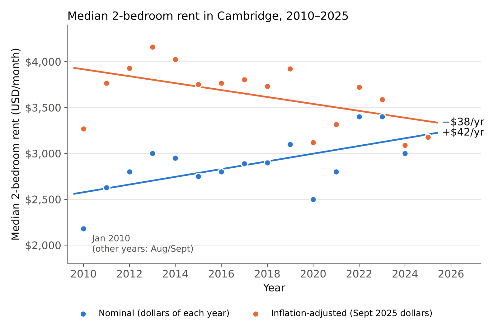

# Cambridge Rent: How Much Do Sources Disagree?

People moving to Cambridge, Massachusetts for school or work get very different answers to a simple question: *what does an apartment cost?* This project compares public rent sources for Cambridge, measures how far apart they are, and explains why.

**Project website:** `https://alice-zWang.github.io/cambridge-rent-sources/` (see [Publishing the website](#publishing-the-website))


## Key findings

1. **Sources disagree by almost $1,000 a month.** Seven public sources put typical Cambridge rent (all apartment sizes) between **$2,742** (Census, all renters, 2019–2023) and **$3,707** (Point2, listings, Nov 2025). The listing sites alone span $3,300–$3,707.
2. **The city's listings run above HUD's benchmark, but the gap is closing.** For 2-bedrooms, the City of Cambridge median was higher than HUD's Fair Market Rent in all 10 paired years, by **$818 on average** (paired t = 4.99, df = 9, p = 0.0008). The gap fell from **$1,546 in 2013 to $234 in 2025**, as HUD's metro figure doubled (+102%) while the city's rose 6%.
3. **Rents rise in dollars but not after inflation.** In the city's data, median 2-bedroom rent rose about **$42 a year** in nominal dollars (t = 3.16, p = 0.007) but fell about **$38 a year** in Sept 2025 dollars (t = −2.36, p = 0.034), 2010–2025. Both results hold when the January 2010 and COVID-2020 values are removed.

Why sources differ: **who is counted** (new listings vs. all renters), **average vs. median**, **which listings** (market-rate only, large managed buildings), and **where and when** (Cambridge vs. the Boston metro; 2019 to 2026).

| City listings vs. HUD, 2-bedroom | Real vs. nominal rent, 2-bedroom |
|---|---|
|  |  |

## Repository structure

```
cambridge-rent-sources/
├── analysis/                 Python scripts (run_all.py rebuilds everything)
│   ├── 01_rent_trend_tests.py    t-tests for slope, sensitivity checks, figures 1–3
│   └── 02_compare_sources.py     source comparison, paired t-test, figures 4–6
├── data/
│   ├── raw/                  Collected data, with sources (see data/README.md)
│   └── processed/            Built by the scripts
├── results/                  Test results (CSV / JSON)
├── figures/                  Charts (PNG)
├── methods/
│   ├── research-design.md        Question, evaluation, refined questions, methods
│   ├── coding-framework.md       Deductive codebook for source documentation
│   ├── ethics-checklist.md       Consent, privacy, harm, power, IRB
│   └── positionality.md          Researcher positionality statement
└── docs/                     Project website (GitHub Pages)
```

## Reproduce the analysis

Requires Python 3.9+.

```bash
pip install -r requirements.txt
python analysis/run_all.py
```

This rewrites everything in `results/`, `figures/` and `docs/assets/` from `data/raw/`.

## Methods

- **Statistical tests:** least-squares regression of median rent on year with a t-test for the slope (H₀: β = 0, two-sided, α = 0.05), checked with residual plots and a Shapiro–Wilk test; a paired t-test on the yearly city–HUD gap; a regression of the gap on year.
- **Qualitative coding:** a deductive codebook (7 codes, 21 sub-codes) applied to the documentation of 10 city housing datasets. See [methods/coding-framework.md](methods/coding-framework.md).
- **Ethics and positionality:** see [methods/ethics-checklist.md](methods/ethics-checklist.md) and [methods/positionality.md](methods/positionality.md).

## Data sources

| Source | What it measures |
|---|---|
| [City of Cambridge, Median Residential Rents](https://data.cambridgema.gov/d/n9xk-8wft) | Median advertised market-rate rent, citywide, by bedroom count, 2010–2025 |
| [HUD Fair Market Rents](https://www.huduser.gov/portal/datasets/fmr.html) | 40th-percentile gross rent, Boston-Cambridge-Quincy metro |
| [Census QuickFacts](https://www.census.gov/quickfacts/fact/table/cambridgecitymassachusetts/INC110223) | Median gross rent, all renter households, 2019–2023 |
| Zillow, Apartments.com, Zumper, Redfin, RentCafe, Point2 | Published average or median listed rent (links in `data/raw/`) |

Full details and collection dates are in [data/README.md](data/README.md).

## Limitations

- The city data is not a random sample, and yearly values in a time series are not independent, so p-values are approximate.
- HUD figures cover the whole Boston metro and were available for 11 fiscal years only; the FY2025 values are HUD's originals, which HUD later revised.
- Commercial site figures are one-time snapshots from different months and use different methods.
- No neighborhood-level rents, no studios in the city data, and no Zillow rent history or Census rent-by-bedroom series yet.

## Publishing the website

1. Push this repository to GitHub as `cambridge-rent-sources`.
2. In the repository, open **Settings → Pages**.
3. Under **Build and deployment**, choose **Deploy from a branch**, branch `main`, folder `/docs`, and save.
4. After a minute the site is live at `https://<your-username>.github.io/cambridge-rent-sources/`. Replace `<your-username>` in this README and in `CITATION.cff`.

## Author

**Zhaohan (Alice) Wang**, Cambridge, MA. Independent research project, 2026.

AI tools (Claude) were used to help collect public data, write analysis code and draft documentation. All figures can be checked against the sources listed above and rebuilt with the included scripts.

## License

Code is released under the [MIT License](LICENSE). Text and figures are released under [CC BY 4.0](https://creativecommons.org/licenses/by/4.0/). Data remains subject to the terms of its original publishers.
