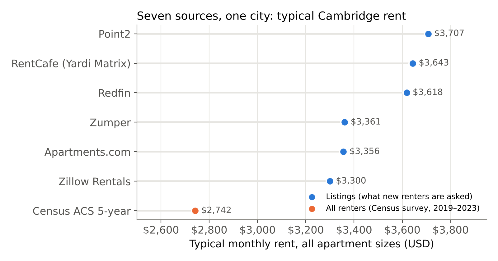
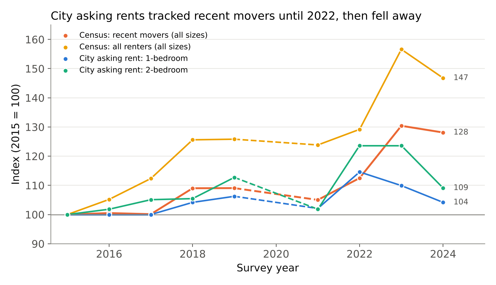
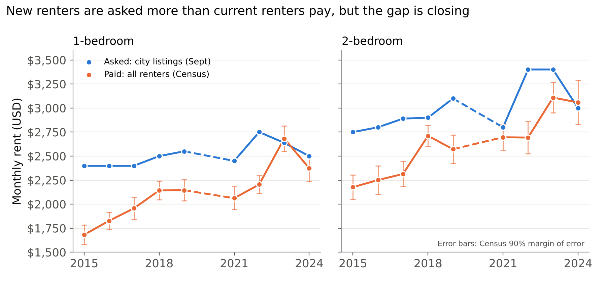
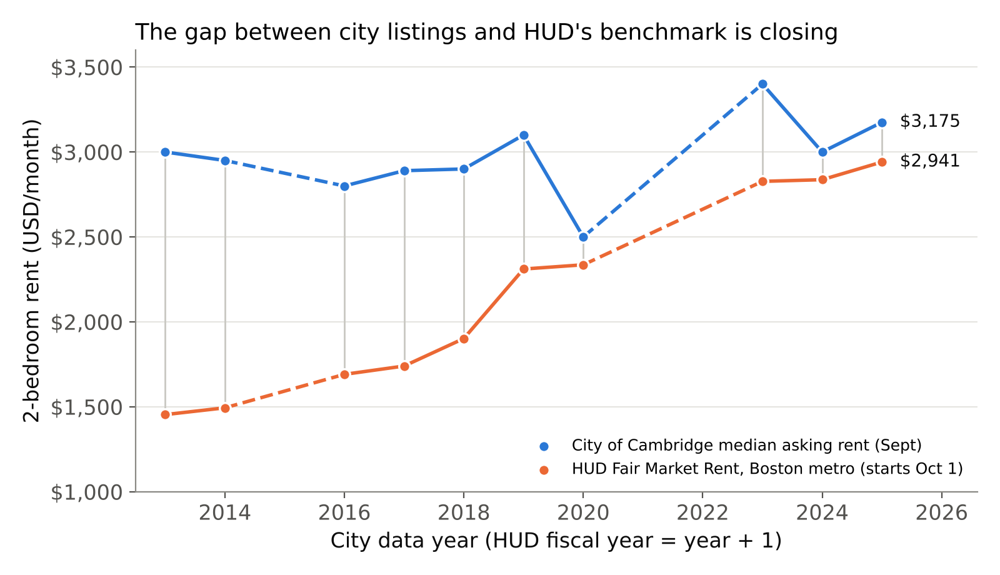

# Cambridge Rent: How Much Do Sources Disagree?

People moving to Cambridge, Massachusetts for school or work get very different answers to a simple question: *what does an apartment cost?* This project compares public rent sources for Cambridge, measures how far apart they are, and explains why.

**Project website:** [alice-zwang.github.io/cambridge-rent-sources](https://alice-zwang.github.io/cambridge-rent-sources/)



## Key findings

1. **Sources disagree by almost $1,000 a month.** Seven public sources put typical Cambridge rent (all apartment sizes) between **$2,742** (Census, all renters, 2019–2023) and **$3,707** (Point2, listings, Nov 2025). The listing sites alone span $3,300–$3,707.
2. **The city's listings run above HUD's benchmark, but the gap is closing.** For 2-bedrooms, the City of Cambridge median was higher than HUD's Fair Market Rent in all 10 paired years, by **$818 on average** (paired t = 4.99, df = 9, p = 0.0008). The gap fell from **$1,546 in 2013 to $234 in 2025**, as HUD's metro figure doubled (+102%) while the city's rose 6%.
3. **New renters are asked more than current renters pay, but the gap is closing.** From 2015 to 2024, the city's median asking rent exceeded the Census median rent paid by all renters by **$390 a month for 1-bedrooms** (about 20%, paired t = 5.06, df = 8, p = 0.001) and **$384 for 2-bedrooms** (about 16%, t = 4.42, p = 0.002). Rents paid rose about 40% over the period while the city's asking rents rose 4–9%, so by 2024 the gap had shrunk to $126 (1BR) and −$58 (2BR).
4. **Rents rise in dollars but not after inflation.** In the city's data, median 2-bedroom rent rose about **$42 a year** in nominal dollars (t = 3.16, p = 0.007) but fell about **$38 a year** in Sept 2025 dollars (t = −2.36, p = 0.034), 2010–2025. Both results hold when the January 2010 and COVID-2020 values are removed.

Why sources differ: **who is counted** (new listings vs. all renters), **average vs. median**, **which listings** (market-rate only, large managed buildings), and **where and when** (Cambridge vs. the Boston metro; 2019 to 2026).

**Is the city's asking-rent series too flat?** HUD and the Census show Cambridge-area rents rising roughly 40–100% over the past decade, while the city's own asking-rent series rose under 10%. A first check uses Census rents for **recent movers** (people who moved in within the last 2–3 years), who pay close to market asking rents. From 2015 to 2024 their rents rose **28%** (2.8% a year, 95% CI 1.4–4.2), versus **4%** for the city's 1-bedroom series (1.0% a year) and **9%** for its 2-bedroom series (1.7% a year). The 1-bedroom difference is significant (−1.8 points a year, p = 0.035); the 2-bedroom difference is not (p = 0.21). The series moved together until 2022 and split in 2023–2024, when the city's medians fell while recent movers' rents stayed high. This points to a possible problem in the city's recent figures, not proof of one.





| City listings vs. HUD, 2-bedroom | Real vs. nominal rent, 2-bedroom |
|---|---|
|  |  |

## Repository structure

```
cambridge-rent-sources/
├── analysis/                 Python scripts (run_all.py rebuilds everything)
│   ├── 00_fetch_census.py        downloads Census data (needs a free API key)
│   ├── 01_rent_trend_tests.py    t-tests for slope, sensitivity checks, figures 1–3
│   ├── 02_compare_sources.py     source comparison, city vs. HUD paired t-test, figures 4–6
│   ├── 03_asked_vs_paid.py       city asking rent vs. Census rent paid, figure 7
│   └── 04_recent_movers.py       city asking rent vs. Census recent movers, figure 8
├── data/
│   ├── raw/                  Collected data, with sources (see data/README.md)
│   └── processed/            Built by the scripts
├── results/                  Test results (CSV / JSON)
├── figures/                  Charts (PNG)
├── methods/
│   ├── research-design.md        Question, evaluation, refined questions, methods
│   ├── coding-framework.md       Deductive codebook for source documentation
│   ├── ethics-checklist.md       Consent, privacy, harm, power, IRB
│   ├── positionality.md          Researcher positionality statement
│   └── annotated-bibliography.md 11 annotated sources (APA), grouped by theme
└── docs/                     Project website (GitHub Pages)
```

## Reproduce the analysis

Requires Python 3.9+.

```bash
pip install -r requirements.txt
python analysis/run_all.py
```

This rewrites everything in `results/`, `figures/` and `docs/assets/` from `data/raw/`. To re-download the Census data, get a free key at [api.census.gov/data/key_signup.html](https://api.census.gov/data/key_signup.html), then run `CENSUS_API_KEY=your_key python analysis/00_fetch_census.py`. Never commit the key.

## Methods

- **Statistical tests:** least-squares regression of median rent on year with a t-test for the slope (H₀: β = 0, two-sided, α = 0.05), checked with residual plots and a Shapiro–Wilk test; paired t-tests on the yearly city–HUD and city–Census gaps; regressions of each gap on year.
- **Qualitative coding:** a deductive codebook (7 codes, 21 sub-codes) applied to the documentation of 10 city housing datasets. See [methods/coding-framework.md](methods/coding-framework.md).
- **Literature:** an [annotated bibliography](methods/annotated-bibliography.md) of 11 sources on how rent data are built, why asking and paid rents diverge, and listing data as research data.
- **Ethics and positionality:** see [methods/ethics-checklist.md](methods/ethics-checklist.md) and [methods/positionality.md](methods/positionality.md).

## Data sources

| Source | What it measures |
|---|---|
| [City of Cambridge, Median Residential Rents](https://data.cambridgema.gov/d/n9xk-8wft) | Median advertised market-rate rent, citywide, by bedroom count, 2010–2025 |
| [HUD Fair Market Rents](https://www.huduser.gov/portal/datasets/fmr.html) | 40th-percentile gross rent, Boston-Cambridge-Quincy metro |
| [Census QuickFacts](https://www.census.gov/quickfacts/fact/table/cambridgecitymassachusetts/INC110223) | Median gross rent, all renter households, 2019–2023 |
| [Census ACS 1-year, table B25113](https://www.census.gov/data/developers/data-sets/acs-1year.html) | Median gross rent by year the household moved in, Cambridge city, 2015–2024 |
| [Census ACS 1-year, table B25031](https://www.census.gov/data/developers/data-sets/acs-1year.html) | Median gross rent by bedroom count, all renter households, Cambridge city, 2015–2024 |
| Zillow, Apartments.com, Zumper, Redfin, RentCafe, Point2 | Published average or median listed rent (links in `data/raw/`) |

Full details and collection dates are in [data/README.md](data/README.md).

## Limitations

- The city data is not a random sample, and yearly values in a time series are not independent, so p-values are approximate.
- HUD figures cover the whole Boston metro and were available for 11 fiscal years only; the FY2025 values are HUD's originals, which HUD later revised.
- Commercial site figures are one-time snapshots from different months and use different methods.
- Census 1-year estimates have margins of error of roughly ±$90–230 for 1- and 2-bedrooms, and 2020 has no standard release. Census gross rent includes utilities and the city's asking rent usually does not, so the asked-vs-paid gap is, if anything, understated. The 2024 3-bedroom value is top-coded at $3,500+.
- The Census "recent movers" group covers a different window each year (from 1 to about 3 years) and mixes all apartment sizes, so it can only be compared with the city series on growth, not level.
- No neighborhood-level rents, no studios in the city data, and no Zillow rent history yet.

## Author

**Zhaohan (Alice) Wang**, Cambridge, MA. Independent research project, 2026.

AI tools (Claude) were used to help collect public data, write analysis code and draft documentation. All figures can be checked against the sources listed above and rebuilt with the included scripts.

## License

Code is released under the [MIT License](LICENSE). Text and figures are released under [CC BY 4.0](https://creativecommons.org/licenses/by/4.0/). Data remains subject to the terms of its original publishers.
