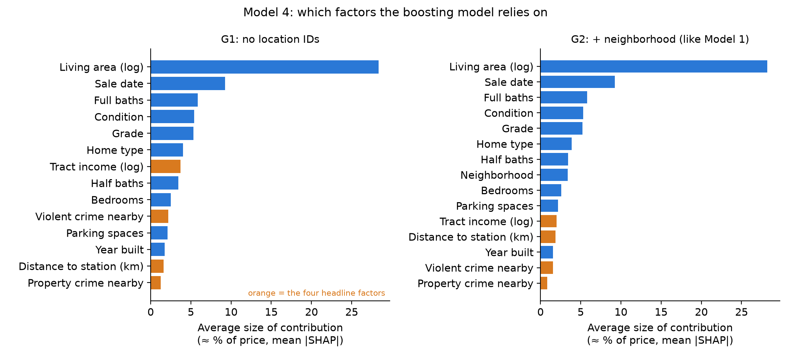
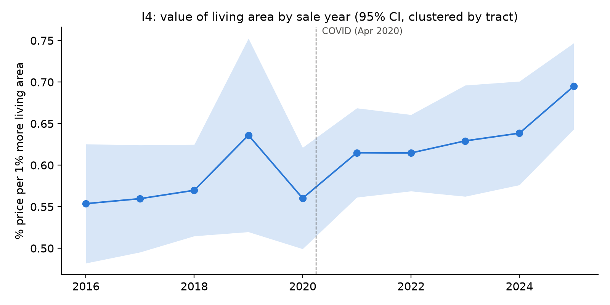
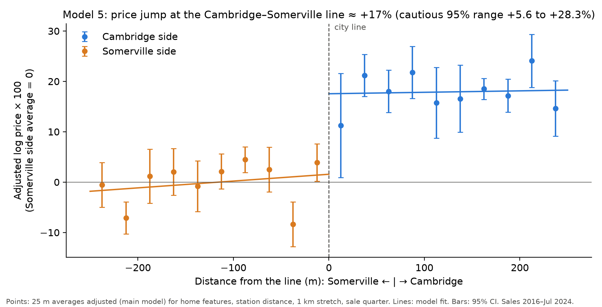
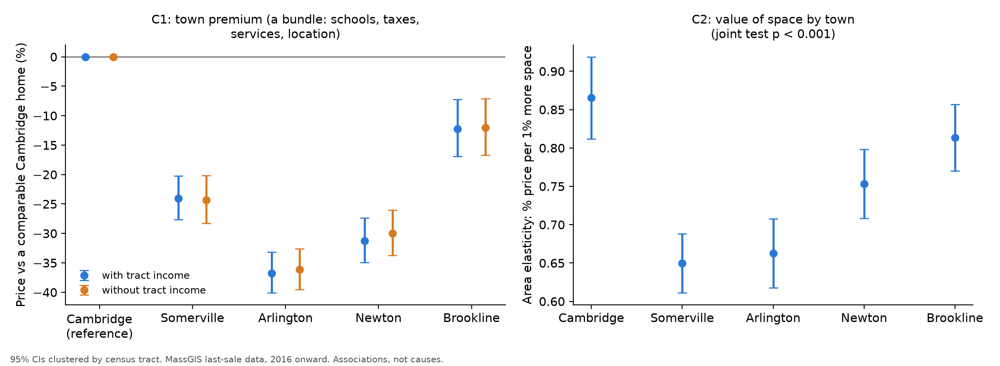

# What Drives Home Prices in Cambridge?

*A study of 8,823 home sales, 2016–2025, using free public data. Prepared November 2026.*

All numbers are **associations** unless labeled otherwise: they describe how prices differ between
similar homes, not what would happen if a policy changed something. Each finding carries one of
three labels:
- **Association:** a pattern in the data.
- **Suggestive of causal:** the design rules out the most obvious alternative explanations.
- **Not answerable:** these data cannot answer the question.

---

## Summary of findings

1. **A home's price is set mostly by the home itself and by when it sold.** Size, bathrooms,
   condition and construction quality matter most. A comparable home sold for about **50% more in
   2025 than in 2016**, or about **13% more after inflation**.
2. **Within a neighborhood, crime, neighborhood income and distance to the T show no measurable
   price difference.** Three different methods agree. This says nothing about differences
   *between* neighborhoods, which the method sets aside. *(Association)*
3. **Space has become more valuable.** The extra price for each additional square foot rose
   steadily over the decade. *(Association, found by two methods)*
4. **Being in Cambridge carries a premium.** Comparable homes just across the line in Somerville
   sell for about **17% less** (range 6% to 28%). Cambridge's lower tax rate alone could explain
   8–11%. *(Suggestive of causal, for the whole "Cambridge bundle")*
5. **Whether schools raise home prices cannot be answered with these data.** Both Cambridge and
   Somerville use school choice, not neighborhood zones. Across five towns, test scores do not line
   up with price premiums. *(Not answerable)*

---

## What we studied

**Question:** how do unit type and size, crime, neighborhood income, schools, distance to the T
and time relate to home sale prices, including interactions between them?

**Data** (all free and public):
- **Sales:** the City of Cambridge Property Database (2016–2025 sales).
- **Crime:** Cambridge Police crime reports.
- **Neighborhood income:** U.S. Census, American Community Survey (ACS) 2020–2024, by census tract.
- **Stations:** MBTA station locations, with the Green Line Extension opening dates.
- **Other towns:** state assessor files for Somerville, Arlington, Newton and Brookline (MassGIS).
- **Schools and taxes:** school test scores and spending from the state Department of Elementary
  and Secondary Education (DESE); tax rates from the state Division of Local Services (DLS).

**Cleaning:**
- Removed $0/$1 and other non-market transfers (8,054 sales at or below $1,000).
- Removed non-residential properties, sales of several parcels on one deed, and sales far below
  the assessed value.
- Removed **201 likely deed-restricted affordable-home resales**, whose prices are capped by deed.
  The database does not mark them; they were identified because both their price and their
  assessed value are below half the usual level.

Every step is logged in [`results/hedonic/cleaning_log.csv`](results/hedonic/cleaning_log.csv).

**Safeguards:**
- Every model and test was written down and committed **before** it was run. Anything added after
  seeing results is labeled as such.
- Uncertainty is shown as 95% ranges. Where methods disagree, the **wider, more cautious** range is
  reported.

---

## Findings

### 1. The home itself and time explain most of the price
*(Association; 85% of price differences explained)*

These are comparisons between otherwise similar homes in the same neighborhood, sold in the same
quarter:

| Feature | Price difference | 95% range |
|---|---|---|
| 10% more living area | +6% | +5.5 to +6.7 |
| One more full bathroom | +11% | +9 to +12 |
| One more half bathroom | +7% | +5 to +9 |
| One more parking space | +3% | +2 to +4 |
| One more bedroom (same total size) | +2% | −0.1 to +3.3 |
| Condition "excellent" vs "average" | +21% | +17 to +25 |
| Single-family house vs condo | +13% | +10 to +16 |

- **Prices rose about 50%** for a comparable home between 2016 and 2025. After Boston-area
  inflation (consumer prices rose 33% over the same years), that is about **+13%**. In real terms
  prices peaked in 2021 (+20%) and have eased since. Source: BLS CPI-U, Boston-Cambridge-Newton.
- A flexible machine-learning model, which looks for any pattern on its own, ranks the factors
  the same way: **size by far first**, then sale date, bathrooms, condition and quality.

### 2. Crime, neighborhood income and transit: no measurable difference within neighborhoods
*(Association)*

These compare a typical lower vs higher value (25th vs 75th percentile) of each factor, for similar
homes in the same neighborhood:

| Factor | Price difference | Cautious 95% range |
|---|---|---|
| Violent crime nearby (10 → 36 per km² per year) | +0.2% | −0.9 to +3.6 |
| Property crime nearby | +0.7% | −1.7 to +3.9 |
| Tract median income | +0.3% | −3.3 to +4.2 |
| Distance to nearest station (510 → 910 m) | −4.0% | −9.3 to +4.4 |

- All four ranges include zero, so these factors add nothing measurable **within** a neighborhood.

**What this does and does not say.** The model compares each home only with homes in its own
neighborhood. Differences *between* neighborhoods are set aside: Mid-Cambridge vs The Port, for
example. So this result **does not show that crime, income or transit don't matter between
neighborhoods**. Part of their value may be built into which neighborhood a home is in. The data
cannot separate that from everything else that differs between 12 neighborhoods.

Within neighborhoods these factors vary less than across the city, though not negligibly
([`within_neighborhood_variation.csv`](results/hedonic/within_neighborhood_variation.csv)):

| Factor | Citywide spread (25th → 75th percentile) | Typical spread within one neighborhood | Range of neighborhood averages | Share of variation within neighborhoods |
|---|---|---|---|---|
| Violent crime nearby (reports per km² per year) | 27 | 13 | 5 to 106 | 66% |
| Property crime nearby (reports per km² per year) | 112 | 50 | 16 to 265 | 41% |
| Tract median income | \$41,000 | \$18,000 | \$104,000 to \$174,000 | 79% |
| Distance to nearest station | 400 m | 290 m | 530 m to 2.2 km | 45% |

- **The typical spread inside a neighborhood is about half the citywide spread** for crime and
  income, and about three-quarters for transit. So the within-neighborhood comparison works with
  smaller contrasts than the citywide figures suggest.
- **Some neighborhoods are internally diverse.** That is why a large share of the overall
  variation lies within neighborhoods: crime near a commercial square vs the quiet streets nearby,
  or several tracts with different incomes.
- **Income is the weakest case.** It is measured once per census tract, so within a neighborhood it
  changes only between its few tracts: 31 tracts in 12 neighborhoods in all. That is too few to
  measure a small difference precisely.
- **Transit:** the machine-learning model finds prices roughly flat from 200 m to about 1 km from
  a station, and lower beyond about 1.2 km. Most of those far-away sales are in West Cambridge, so
  distance cannot be separated from other features of that neighborhood. *(Not established)*
- **Spatial check:** homes in the same **building** sell above or below expectations together
  (shared management, views, renovation, reputation). Accounting for this does not change any
  conclusion.

### 3. Space has become more valuable
*(Association)*

- The price elasticity of living area rose from **0.55 in 2016 to 0.70 in 2025**. In 2016, 10%
  more space went with about 5% higher prices; in 2025, about 7% higher.
- The rise was **gradual**, not a sudden jump at COVID.
- It is the strongest of the four interactions tested in advance. On its own test it is clearly
  above zero; after correcting for testing four interactions, it is borderline (p = 0.08 to 0.11,
  depending on whether the deed-restricted sales are included).
- The machine-learning model, which was never told to look for it, ranks it as the 3rd-strongest of
  105 possible interactions.
- The other planned interactions (income × transit, bedrooms × transit, crime × income) were not
  established.

### 4. The "Cambridge premium" at the Somerville line
*(Suggestive of causal)*

- **Method:** similar homes within 250 m of each side of the 7.7 km Cambridge–Somerville line, on
  the same stretch of the line and sold in the same quarter, about 1,000 sales per side. Homes 100 m
  apart share the same streets, shops and stations. What changes at the line is the city.
- **Result:** Cambridge-side homes sell for **about 17% more** (cautious range **+6% to +28%**).
- **Checks:** the jump is the same within 100 m or 500 m of the line, for condos only, and with
  or without controls for station distance and income.
- **Placebo test:** "fake" lines drawn 400 m inside each city show no jump.

**What the 17% contains:**
- **Taxes:** the FY2025 residential rate is \$6.35 per \$1,000 in Cambridge vs \$10.91 in Somerville.
  Treated as a permanent saving, the difference is worth roughly **8–11% of a home's value**.
- **Schools:** which district's schools a family may choose from.
- **City services:** services, parking rules and everything else that differs by city.

The estimate is above the tax-only range, but its uncertainty range includes it. So **the data
cannot show that anything beyond taxes is priced in.**

**Wider context:** across the two whole cities, comparable Cambridge homes sell for about 32% more
than Somerville homes. At the line the gap is 17%, so about half of the citywide difference is
about *where* homes are located, not the city line itself.

### 5. Schools: not answerable with these data
*(Not answerable)*

- **Within Cambridge:** school assignment is by Controlled Choice, so school quality does not change
  with address.
- **At the Somerville line:** Somerville also uses school choice. Crossing the line changes the
  set of district schools a family may choose from, but it also changes taxes and services at the
  same moment.
- **Across five towns:**

| Town | Price vs comparable Cambridge home | Test scores: % meeting standard | Spending per pupil | Residential tax rate |
|---|---|---|---|---|
| Cambridge | reference | 57% | \$32,000 | \$6.35 |
| Brookline | −12% | 75% | \$22,700 | \$9.87 |
| Somerville | −24% | 42% | \$22,400 | \$10.91 |
| Newton | −31% | 73% | \$21,700 | \$9.80 |
| Arlington | −37% | 74% | \$16,300 | \$10.77 |

- **Test scores do not line up with the town premium.** Arlington and Newton score as high as
  Brookline but have the lowest premiums.
- With five towns, schools cannot be separated from location, taxes and services.

### 6. Rents (small check)
*(Association)*

- **Why only a check:** no free data give rents for individual apartments. Census median rents
  by tract (31 tracts) were compared with the same factors.
- **Income:** only neighborhood income lines up with rent: rank correlation +0.55, 95% range
  +0.22 to +0.77 (a bootstrap check gives +0.19 to +0.83). With only 31 tracts the range is wide.
  Part of the link is built in, because renters' incomes are part of tract income.
- **Crime and transit:** no clear relationship with rent.
- **Rents and condo prices:** they rank tracts differently (correlation +0.14). Tract median rents
  are a blunt measure for two reasons.
  - They mix market, subsidized and student housing.
  - They are rents **paid by all current renters**, including tenants on leases signed years
    ago, not the rents asked of new tenants today. Long-term tenancies keep them below current
    market rents and slow to respond to neighborhood changes.

---

## Correlation vs causation

- **Findings 1–3 and 6 are associations.**
  - For example, "one more bathroom, 11% higher price" compares homes as they are. It does not
    promise that adding a bathroom raises a home's value by 11%.
  - "Crime shows no measurable difference" does not mean crime does not matter. It means that,
    *within neighborhoods*, these data cannot detect a difference.
- **Finding 4 comes closest to cause and effect.** Homes on either side of a city line are nearly
  alike in location, and the placebo test passes. It still measures the **whole bundle** of
  being in Cambridge, not any single part.
- **Finding 5 cannot be answered** with public data.

## Limitations

- **Features at assessment time:** the city records features when it assesses a home, not
  necessarily at the time of sale. Renovations in between add error.
- **Coarser data for other towns:** the state files for other towns record only each home's latest
  sale, and they lack bathrooms, condition and quality. Comparisons between towns are therefore
  coarser than those within Cambridge.
- **Crime records:** they reflect reporting as well as risk, and are located by reporting area, not
  exact address.
- **Few areas:** Cambridge has only 12 neighborhoods and 31 tracts, so uncertainty about
  neighborhood-level factors is large.
- **Deed-restricted sales:** they were identified from a price-and-assessment pattern, not from
  an official list. Results with and without them lead to the same conclusions.
- **Selection:** homes that sell are not a random sample of all homes.

---

## Where to find the details

- **Plain-language phase summaries:** in `results/hedonic/`:
  - [Phase 2](results/hedonic/PHASE2_SUMMARY.md): main model.
  - [Phase 3](results/hedonic/PHASE3_SUMMARY.md): interactions and the spatial check.
  - [Phase 4](results/hedonic/PHASE4_SUMMARY.md): machine learning and five towns.
  - [Phase 5](results/hedonic/PHASE5_SUMMARY.md): the city line.
- **Pre-registered rules:** `analysis/hedonic/SPEC_*.md`.
- **Scripts:** `analysis/hedonic/` (numbered in run order).
- **Figures:** `figures/hedonic/`.
- **Data sources and checksums:** [`data/raw/hedonic/SOURCES.md`](data/raw/hedonic/SOURCES.md).
- **Plan:** [`PLAN.md`](PLAN.md).

## Glossary

- **Comparable / similar homes:** homes matched on the features in the data (size, rooms,
  bathrooms, condition, type, age), in the same neighborhood or stretch of the city line, sold in
  the same quarter.
- **95% range:** the range of values consistent with the data. The "cautious" range uses a method
  designed for the small number of neighborhoods or tracts, and is usually wider.
- **Elasticity:** the % change in price for a 1% change in size.
- **Placebo test:** running the same analysis where no effect should exist. Finding none there
  supports the main result.
- **Census tract:** a Census area of about 4,000 people. Cambridge has 31 with home sales.
